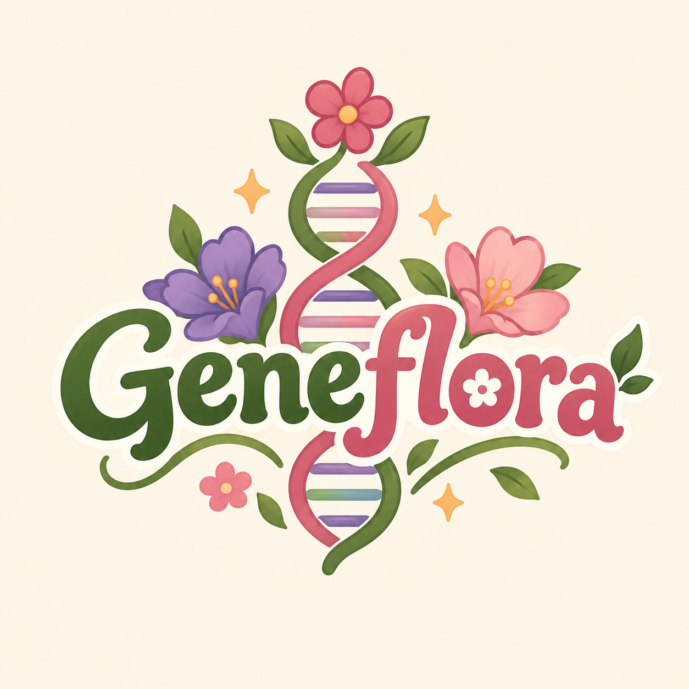

<h1 align="left">
  
  Geneflora
</h1>

<table align="center">
  <tr>
    <td align="center">
      
    </td>
    <td align="center">
      
    </td>
    <td align="center">
      
    </td>
  </tr>
</table>

<h2 align="left">
  
  Contextualização
</h2>

O **Geneflora** é um jogo digital educativo desenvolvido como projeto final da disciplina **Jogos Digitais como Ferramenta Pedagógica**, ofertada pelo Instituto Metrópole Digital (IMD/UFRN).

O projeto tem como propósito explorar o potencial dos jogos digitais como instrumentos de apoio ao processo de ensino-aprendizagem, utilizando elementos de simulação, gerenciamento e interação para abordar conteúdos relacionados à genética e à hereditariedade.

Ambientado em uma floricultura, o jogo propõe uma experiência lúdica na qual o jogador participa de atividades de cultivo, atendimento a clientes e resolução de desafios envolvendo características hereditárias das plantas. Dessa forma, busca aproximar conceitos científicos de situações interativas, favorecendo a experimentação e a aprendizagem por meio da prática.

<h2 align="left">
  
  Sobre o jogo
</h2>

Em Geneflora, o jogador assume a rotina de uma floricultura, realizando atividades relacionadas ao cultivo de plantas e ao atendimento de clientes.

Entre as propostas de interação estão:

- Cultivo e cuidado de diferentes flores;
- Exploração de características genéticas;
- Resolução de desafios envolvendo cruzamentos genéticos;
- Atendimento a clientes e gerenciamento de pedidos;
- Descoberta de diferentes combinações de características hereditárias.

<h2 align="left">
  
  Objetivo pedagógico
</h2>

O jogo busca auxiliar na compreensão de conceitos relacionados à genética mendeliana, especialmente:

- Genótipo e fenótipo;
- Alelos dominantes e recessivos;
- Hereditariedade;
- Cruzamentos genéticos;
- Primeira Lei de Mendel.

A proposta está relacionada à habilidade **EF09CI09 da BNCC**, que aborda os princípios da hereditariedade e os experimentos de Mendel.

<h2 align="left">
  
  Tecnologias e ferramentas
</h2>

<table>
  <thead>
    <tr>
      <th align="left" width="25%">Ferramenta</th>
      <th align="left">Utilização no projeto</th>
    </tr>
  </thead>
  <tbody>
    <tr>
      <td align="left"><strong>GDevelop 5</strong></td>
      <td>Desenvolvimento do jogo e implementação das mecânicas.</td>
    </tr>
    <tr>
      <td align="left"><strong>Git e GitHub</strong></td>
      <td>Versionamento e gerenciamento do projeto.</td>
    </tr>
    <tr>
      <td align="left"><strong>ChatGPT (OpenAI)</strong></td>
      <td>Apoio no desenvolvimento, elaboração de ideias, esclarecimento de dúvidas e geração de imagens e recursos visuais.</td>
    </tr>
    <tr>
      <td align="left"><strong>Canva</strong></td>
      <td>Criação e edição de elementos gráficos.</td>
    </tr>
    <tr>
      <td align="left"><strong>Audacity</strong></td>
      <td>Edição e tratamento de áudios.</td>
    </tr>
    <tr>
      <td align="left"><strong>Freesound</strong></td>
      <td>Obtenção de efeitos sonoros e recursos de áudio.</td>
    </tr>
  </tbody>
</table>

<h2 align="left">
  
  Organização do projeto
</h2>

Os recursos do jogo estão organizados em pastas para facilitar o desenvolvimento e a manutenção:

- `Assets/`: recursos visuais e sonoros;
  - `Cenários/`: cenários e ambientes;
  - `Clientes/`: personagens;
  - `Efeitos/`: efeitos visuais;
  - `Elementos Cultivo/`: vasos, flores, sementes, adubos e ferramentas de jardinagem;
  - `Elementos Floricultura/`: elementos relacionados à estrutura e decoração da floricultura;
  - `Fontes/`: fontes tipográficas;
  - `IU/`: elementos da interface;
  - `Músicas/`: músicas;
  - `Sons/`: efeitos sonoros.

<h2 align="left">
  
  Equipe de desenvolvedores
</h2>

<table align="center">
  <tr>
    <td align="center" width="25%">
      
    </td>
    <td align="center" width="25%">
      
    </td>
    <td align="center" width="25%">
      
    </td>
    <td align="center" width="25%">
      
    </td>
  </tr>
  <tr>
    <td align="center"><strong>Luiz Felipe</strong></td>
    <td align="center"><strong>Lucas Toshio</strong></td>
    <td align="center"><strong>Sarah Lima</strong></td>
    <td align="center"><strong>Vanessa Alves</strong></td>
  </tr>
  <tr>
    <td align="center" valign="top">
      Desenvolvedor  e designer gráfico
    </td>
    <td align="center" valign="top">
      Desenvolvedor
    </td>
    <td align="center" valign="top">
      Game Designer Educacional e roteirista
    </td>
    <td align="center" valign="top">
      Game Designer Educacional
    </td>
  </tr>
</table>